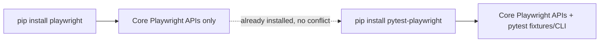

# Playwright with Pytest Plugin — Revision Notes

## 1. Playwright vs Playwright + Pytest Plugin

| Aspect | `pip install playwright` (core) | `pip install pytest-playwright` |
|---|---|---|
| What you get | Core Playwright APIs for browser automation | Core Playwright APIs **+** pytest integration |
| Fixtures (page, browser, context) | Manual setup required | Built-in fixtures — no manual setup |
| CLI options | Not available | `--browser`, `--headed`, `--headless`, `--slowmo`, `--device`, `--output`, `--tracing`, `--video`, `--screenshot`, `--full-page-screenshot` |
| Best suited for | Quick scripting / one-off browser automation | Building a structured testing project/framework |
| Test structure | No enforced structure | Follows pytest conventions (`test_*.py`, `assert`) |

**Key point:** `pytest` itself is a general-purpose Python testing framework — not exclusive to Playwright. `pytest-playwright` is the plugin that bridges Playwright with pytest's fixture/CLI ecosystem.

## 2. Can I install pytest-playwright after already installing playwright?

**Yes — no conflict.** They are compatible and commonly used together.

- If starting a **new project**: just run `pip install pytest-playwright` directly (skip plain `pip install playwright`).
- If you **already have** `playwright` installed in an existing project: you do **not** need to uninstall anything. Simply run `pip install pytest-playwright` in the same environment — it adds the pytest integration on top of the existing core APIs.



## 3. Setup / Demo Steps

1. Activate virtual environment:
   ```
   venv1\Scripts\activate
   ```
   (deactivate with `deactivate`)
2. Install the plugin:
   ```
   pip install pytest-playwright
   ```
   (if some packages already exist → "requirement already satisfied")
3. Install browser binaries:
   ```
   playwright install
   ```
4. Verify installations:
   ```
   playwright --version
   pytest --version
   pip list
   pip show pytest-playwright
   ```
5. Create a test file — **must be named `test_*.py`** so pytest auto-discovers it (unless you explicitly pass the filename).
   ```python
   def test_example():
       assert 1 + 1 == 2
   ```
6. Run the test:
   ```
   pytest test_sample.py
   ```
   - Pass → shows "passed"
   - Fail (e.g., `assert 1 + 1 == 4`) → shows assertion failure details

## 4. Sample Playwright + Pytest Script

```python
from playwright.sync_api import sync_playwright

def test_google_title(page):
    page.goto("https://www.google.com")
    assert "Google" in page.title()
```

Note: with the `page` fixture, no manual browser/context setup is needed — pytest-playwright handles it.

## 5. Key Features Unlocked by the Plugin

- **Built-in fixtures**: `page`, `browser`, `context` — used directly as test function arguments, no manual instantiation.
- **CLI arguments** (passed alongside `pytest` command):
  - `--browser <name>` — choose browser (chromium/firefox/webkit)
  - `--headed` / headless (default)
  - `--browser-channel`
  - `--slowmo`
  - `--device`
  - `--output <dir>`
  - `--tracing`
  - `--video`
  - `--screenshot` / full-page screenshot options
- Reference: official Playwright + pytest documentation lists all fixtures and CLI args in detail.

## 6. Interview Q&A

**Q1: What is the difference between `playwright` and `pytest-playwright`?**
A: `playwright` gives only the core browser-automation APIs. `pytest-playwright` adds pytest integration — built-in fixtures (page, browser, context) and extra CLI options (headed/headless, browser choice, tracing, video, screenshots) on top of the core APIs.

**Q2: If playwright is already installed, do I need to uninstall it before adding the pytest plugin?**
A: No. They are compatible. Just run `pip install pytest-playwright` in the same project/environment — it layers pytest support on top of the existing installation.

**Q3: Why use pytest with Playwright instead of plain Playwright scripts?**
A: Plain Playwright is fine for simple scripting/automation. For building an actual **testing framework/project** (structured test suites, fixtures, CLI-driven execution, reporting), pytest-playwright is far more efficient.

**Q4: What is `pytest` in general (outside of Playwright)?**
A: A general-purpose Python testing framework, usable with many libraries, not just Playwright.

**Q5: How does pytest discover test files?**
A: By naming convention — files must be prefixed with `test_` (e.g., `test_sample.py`), unless the filename is explicitly passed to the `pytest` command.

**Q6: What command verifies both Playwright and pytest-playwright are installed correctly?**
A: `playwright --version`, `pytest --version`, and `pip show pytest-playwright` (shows version, summary, homepage/GitHub link).

**Q7: Give an example of a CLI option used with pytest-playwright.**
A: `pytest --browser firefox --headed` — runs tests in a headed Firefox browser instance.

## 7. Revision Checklist

- [ ] Understand core `playwright` vs `pytest-playwright` distinction
- [ ] Know that installing the plugin over an existing `playwright` install causes no conflict
- [ ] Can activate/deactivate a virtual environment
- [ ] Know install sequence: `pip install pytest-playwright` → `playwright install` → verify versions
- [ ] Know `test_*.py` naming convention for pytest discovery
- [ ] Can write a basic `assert`-based pytest test
- [ ] Understand built-in fixtures: `page`, `browser`, `context`
- [ ] Know key CLI flags: `--browser`, `--headed`, `--slowmo`, `--device`, `--tracing`, `--video`, `--screenshot`
- [ ] Can write a simple Playwright+pytest script using the `page` fixture (e.g., navigate + assert title)
