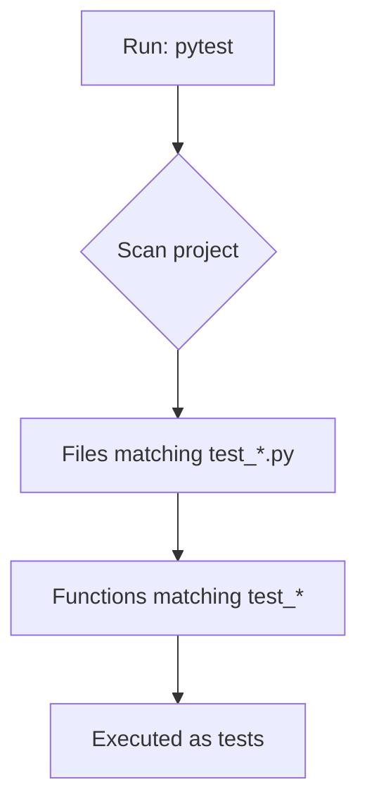
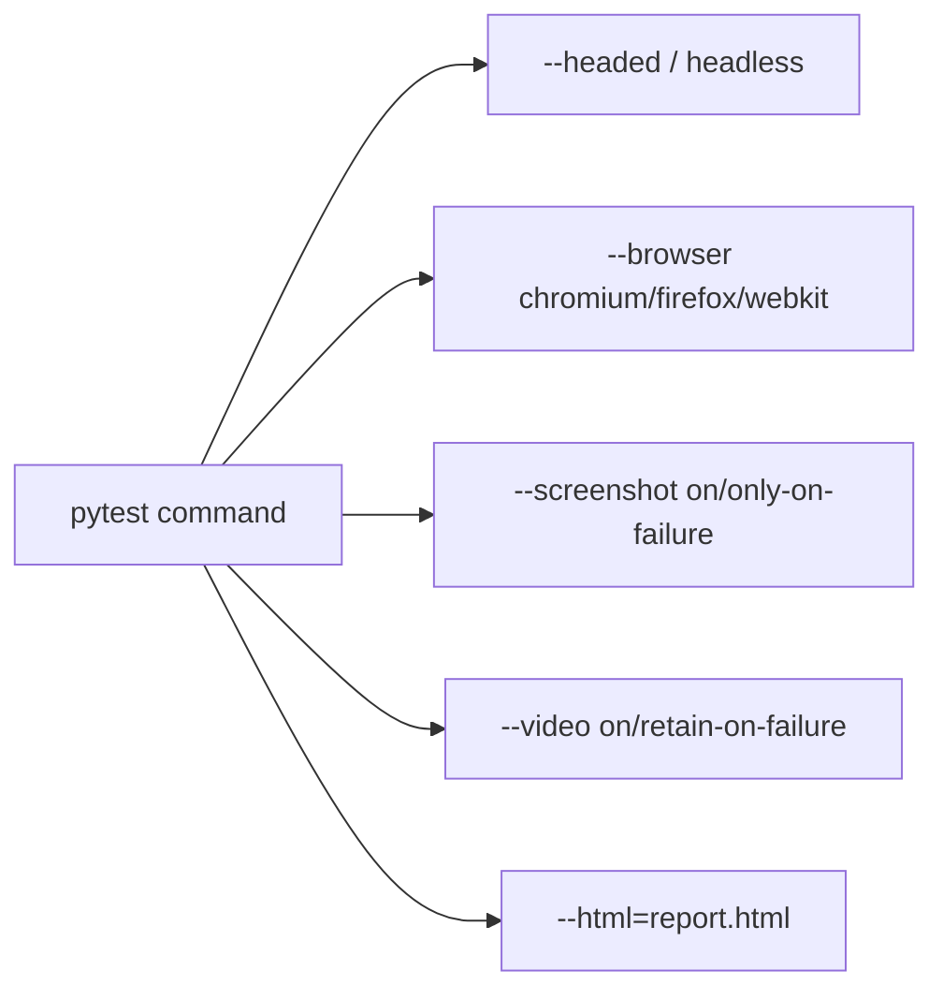

# Writing Your First Playwright + Pytest Test — Revision Notes

## 1. What Counts as a "Test" in Pytest?

- A **function whose name starts with `test_`** is treated as a test by pytest.
- The **file name** should also contain `test` (convention: `test_*.py`).
- When you run the `pytest` command, it auto-discovers all such files/functions — you don't need to specify a file, though you can.



## 2. Project Structure Convention

- Create a `tests/` folder (optional but recommended) to keep all test files organized.
- Inside it, create files like `test_google.py`.

```
project/
└── tests/
    └── test_google.py
```

## 3. Anatomy of a Playwright + Pytest Test — Line by Line

### Step 1 — Imports
```python
import re
from playwright.sync_api import expect
```
| Import | Purpose |
|---|---|
| `re` | Regular expressions — used for flexible text/title matching |
| `expect` | Playwright's assertion library — `expect(page).to_have_title(...)` etc. |

### Step 2 — Define the test function with the `page` fixture
```python
def test_google_search(page):
    ...
```
- `page` is a **built-in fixture** auto-injected by `pytest-playwright` — no manual browser/context setup needed.
- Function name **must** start with `test_`.

### Step 3 — Navigate to a URL
```python
page.goto("https://www.google.com/ncr")
```
- `/ncr` = **No Country Redirect** — avoids Google's regional redirect + language popups.
- Indentation (spaces) defines the function block in Python — no `{}` like Java.

### Step 4 — Handle an optional popup (try/except pattern)
```python
try:
    page.get_by_role("button", name="Accept all").click(timeout=5000)
except:
    print("no popup to accept")
```
- Defensive pattern: if a cookie-consent popup appears, accept it; if not, continue without failing.

### Step 5 — Interact with the search box
```python
page.get_by_role("combobox", name="Search").fill("Playwright Python")
```
- `get_by_role` locates elements by their **accessibility role** (combobox, button, etc.) — a robust locator strategy vs. brittle CSS/XPath.
- Element roles/properties can be checked via browser DevTools → right-click → Inspect.

### Step 6 — Simulate pressing Enter
```python
page.keyboard.press("Enter")
```

### Step 7 — Assertion (verification)
```python
expect(page).to_have_title(re.compile("Playwright", re.IGNORECASE))
```
- Uses `re.compile(...)` for pattern matching + `re.IGNORECASE` to ignore case sensitivity.
- `expect(...)` is the pytest-playwright assertion mechanism — fails the test if the condition isn't met.

### Optional additions
```python
page.wait_for_timeout(3000)   # wait 3 seconds (ms-based)
page.pause()                  # opens Playwright Inspector for debugging
```

### Full Test Example
```python
import re
from playwright.sync_api import expect

def test_google_search(page):
    page.goto("https://www.google.com/ncr")
    try:
        page.get_by_role("button", name="Accept all").click(timeout=5000)
    except:
        print("no popup to accept")

    page.get_by_role("combobox", name="Search").fill("Playwright Python")
    page.keyboard.press("Enter")

    expect(page).to_have_title(re.compile("Playwright", re.IGNORECASE))
```

## 4. Running the Test — CLI Options

| Command | Effect |
|---|---|
| `pytest tests/test_google.py` | Runs the test in default (headless) mode |
| `pytest tests/test_google.py --headed` | Opens a visible browser window |
| `pytest tests/test_google.py --browser chromium` | Runs on Chromium (also: `firefox`, `webkit`) |
| `pytest tests/test_google.py --screenshot on` | Captures screenshot(s) (also: `only-on-failure`) |
| `pytest tests/test_google.py --video on` | Records video (also: `retain-on-failure`, `on-first-retry`) |
| `pytest tests/test_google.py --html=report1.html` | Generates an HTML report (needs `pytest-html` installed) |
| `pytest --help` | Lists all available flags (log level, browser, headed, slowmo, maxfail, etc.) |



### Headless vs Headed
| Mode | Browser visible? | Speed/Memory | Use case |
|---|---|---|---|
| Headless (default) | No | Faster, less memory | CI pipelines, background runs, no distraction |
| Headed (`--headed`) | Yes | Slightly slower, more memory | Debugging, visual verification |

### HTML Report
```
pip install pytest-html
pytest tests/test_google.py --html=report1.html
```
- Report shows: Python version, platform, packages/plugins used, base URL, pass/fail details, and **failure logs** (only shown when a test fails).

## 5. Key Concepts Summary

- `get_by_role` — locates elements via accessibility role (recommended over raw CSS selectors for resilience).
- `.fill()` — types text into an input/combobox.
- `page.keyboard.press("Enter")` — simulates a real key press.
- `expect(page).to_have_title(...)` — the core assertion pattern; supports regex for flexible matching.
- Try/except around popups — defensive coding so the test doesn't fail just because an optional UI element didn't appear.
- AI tools (ChatGPT/Copilot) can generate boilerplate tests — but understanding the line-by-line logic lets you read, debug, and modify AI-generated or third-party test code confidently.

## 6. Interview Q&A

**Q1: How does pytest identify a function as a test?**
A: Any function whose name starts with `test_`, inside a file whose name also contains `test` (e.g., `test_google.py`), is auto-discovered and run by the `pytest` command.

**Q2: What is the `page` fixture and where does it come from?**
A: It's a built-in fixture provided by the `pytest-playwright` plugin, automatically injected as an argument into test functions. It gives you a ready-to-use browser page without manual setup.

**Q3: Why use `get_by_role` instead of CSS selectors?**
A: `get_by_role` locates elements based on their accessibility role and accessible name (e.g., button, combobox), which is more resilient to UI/DOM changes than brittle CSS/XPath selectors.

**Q4: What does `/ncr` do when navigating to google.com?**
A: NCR = No Country Redirect. It prevents Google from redirecting to a localized/regional version, avoiding unexpected language or cookie-consent popups during automation.

**Q5: How would you handle an optional popup that may or may not appear?**
A: Wrap the popup-handling logic in a `try/except` block — attempt to click "Accept" with a timeout; if it's not found (exception raised), just continue the test (e.g., print a message).

**Q6: How do you assert the page title in Playwright + pytest?**
A: `expect(page).to_have_title(re.compile("text", re.IGNORECASE))` — uses the `expect` assertion API with an optional regex for flexible, case-insensitive matching.

**Q7: How do you run tests in headed mode vs headless mode? What's the trade-off?**
A: `--headed` shows the actual browser window; default is headless (no visible browser). Headless is faster and uses less memory — good for CI/background runs. Headed is useful for debugging/visual verification.

**Q8: How do you capture screenshots and videos during a test run?**
A: `--screenshot on` (or `only-on-failure`) and `--video on` (or `retain-on-failure`) flags passed to the `pytest` command.

**Q9: How do you generate an HTML test report?**
A: Install `pytest-html` (`pip install pytest-html`), then run with `--html=report.html`. The report includes environment info, plugins used, and failure logs if any test fails.

**Q10: What Python-specific concept replaces `{}` blocks (like in Java) in test functions?**
A: Indentation (whitespace) — Python uses consistent indentation to define code blocks instead of curly braces.

## 7. Revision Checklist

- [ ] Know the `test_*` naming rule for pytest functions and files
- [ ] Can explain the `page` fixture and how it's auto-injected
- [ ] Can write imports: `re` and `from playwright.sync_api import expect`
- [ ] Can write a full test: goto → handle popup (try/except) → fill search → press Enter → assert title
- [ ] Understand `get_by_role` as the preferred locator strategy
- [ ] Know the difference between headless (default) and `--headed` mode
- [ ] Know CLI flags: `--browser`, `--screenshot`, `--video`, `--html`
- [ ] Can install and use `pytest-html` for report generation
- [ ] Understand `expect(page).to_have_title(re.compile(...))` assertion pattern
- [ ] Comfortable explaining AI-generated Playwright/pytest code line by line
